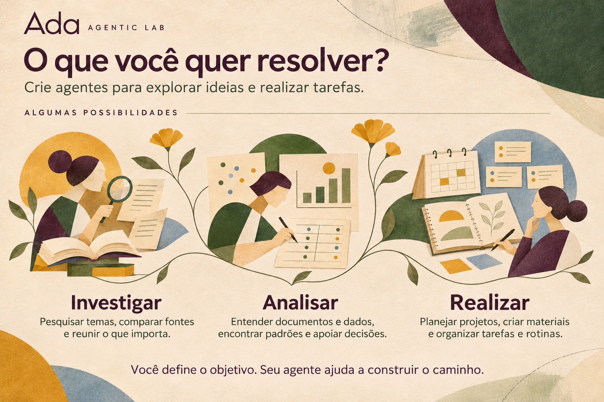

# Documentação da plataforma Ada

Visão da plataforma e desenvolvimento com inteligência artificial

**Visão.** A Ada é um laboratório agêntico para transformar objetivos em agentes reutilizáveis. A proposta é permitir que uma pessoa descreva o desafio, forneça contexto e recursos e acompanhe entregas, sem precisar desenhar um fluxo técnico para cada nova tarefa.

**Tese.** Modelos capazes podem escolher boas estratégias quando recebem um objetivo claro, contexto relevante e ferramentas adequadas. A Ada organiza esse ambiente: dá identidade ao agente, conserva memória e histórico e oferece execução e acompanhamento. O planejamento do modelo convive com autorizações para ações externas e com a revisão humana.

**Objetivo desta versão.** Demonstrar um ciclo de criação, uso e continuidade de agentes em uma plataforma que pode rodar localmente e ter uma instalação privada na nuvem. Pesquisa, análise, criação de materiais e organização de rotinas são possibilidades de aplicação, conforme o motor e os recursos conectados.

Luiz Fernando · 19 de novembro de 2026

---

## Funcionalidades e experiência de uso

**Criar e personalizar.** O usuário escolhe personagem e nome, descreve objetivo e contexto e revisa uma proposta de perfil. O nome pode ser selecionado da base do projeto. Instruções e recursos podem evoluir em versões; cada perfil mantém conversas independentes, com histórico, renomeação, ramificação e exclusão.

**Trabalhar com contexto.** O chat aceita imagens, PDFs com texto e arquivos como CSV, JSON e código. Notas por agente guardam preferências e decisões; resumos persistentes e recuperação de trechos ajudam a manter continuidade. A interface apresenta a mensagem enviada, o progresso e a resposta do agente.

**Executar e revisar.** Workflows salvam objetivos reutilizáveis. O LangGraph executa o agente e pode pausar depois da entrega para revisão. O usuário aprova ou rejeita no histórico, inclusive após reiniciar a aplicação, sem repetir a chamada ao modelo. Essa aprovação conclui a revisão do resultado; a publicação de um PR tem autorização própria.

**Produzir entregas.** Há exportação de respostas salvas para Markdown, PDF, Word, slides e planilha. No motor Claude, ferramentas podem consultar recursos autorizados, preparar arquivos e acionar análises ou propostas de código em sandbox. O caminho Gemini atual permite conversa e análise de anexos, mas ainda não tem paridade com as ferramentas e subagentes do SDK Claude.

---

## Arquitetura e tecnologias

Fluxo: Interface Ada → LangGraph → motor configurado. O grafo executa o agente, pode pausar para revisão e conclui o workflow. Checkpoints persistem em SQLite ou PostgreSQL.

O frontend envia solicitações à API. O backend carrega o perfil, o contexto e as permissões e escolhe o gateway configurado. Nos workflows, o LangGraph conserva os marcos da execução. Com Claude, o Agent SDK decide como trabalhar dentro da tarefa e pode chamar especialistas temporários. O grafo não substitui esse raciocínio por uma sequência rígida de instruções.

| Camada | Tecnologias e contribuição |

|---|---|

| Interface | React, TypeScript e Vite; componentes de chat, perfis e painéis. Google Sans e identidade botânica com referências Bauhaus e Swiss Style. |

| API e contratos | Python, FastAPI, Pydantic e HTTPX; rotas, validação de entradas e comunicação com provedores e serviços. |

| Orquestração | LangGraph e checkpointers para workflows; Claude Agent SDK para execução nativa, skills e subagentes; gateway compatível para Gemini. |

| Dados | SQLite local e PostgreSQL/Supabase com psycopg. Perfis, versões, mensagens, notas, resumos, execuções e checkpoints persistentes. |

| Conexões | OAuth e adaptadores MCP internos para recursos autorizados de GitHub, Figma e Google. As capacidades dependem dos escopos e do serviço. |

| Execução e hospedagem | Docker, VM Ubuntu via Multipass e executor Render opcional. Dockerfile reúne frontend e backend; Render hospeda a instalação privada. |

| Arquivos e validação | pypdf para extração; python-docx, ReportLab, python-pptx e openpyxl para entregas. pytest, Testing Library e node:test verificam comportamentos. |

A memória e a recuperação de documentos usam correspondência textual, não embeddings. Segredos ficam no servidor; recursos externos são conferidos a cada uso. A instalação privada tem autenticação HTTP Basic, TLS no banco e RLS nas tabelas aplicáveis. O modelo não recebe um shell geral do servidor. Código é executado em ambiente isolado, e propostas de PR exigem uma ação explícita.

---

## Uso de IA no desenvolvimento

A concepção e a evolução da Ada foram conduzidas por mim, com IA como apoio ao desenvolvimento. Defini a proposta do produto e participei da ideação da arquitetura, das decisões de implementação e da escolha das funcionalidades. Ao longo das iterações, propus e refinei aspectos como a criação de agentes por objetivo, a memória por perfil, a orquestração com subagentes, os workflows, as conexões externas e a execução de código em ambientes isolados. Também avaliei o comportamento da plataforma, identifiquei problemas e direcionei as correções e prioridades.

Utilizei o Codex para transformar essas decisões em implementações, investigar erros, propor alternativas técnicas, criar e executar testes e apoiar a documentação. O processo foi colaborativo e iterativo: minhas orientações e avaliações conduziram as propostas do assistente e os ajustes no código, nos fluxos e na interface. A IA ampliou minha capacidade de experimentar e implementar ideias, enquanto mantive a direção do produto e as decisões sobre sua evolução.

A identidade visual também foi dirigida por mim. Escolhi as referências artísticas e de design, incluindo a inspiração botânica em Monet e elementos Bauhaus, modernistas e Swiss Style, e defini preferências de cores, tipografia, personagens e composição. A ferramenta de geração de imagens foi utilizada para materializar essa direção em ilustrações, refinadas a partir dos meus comentários e aprovadas por mim. O diagrama técnico foi produzido por código para representar a arquitetura implementada.

### Validação e alcance da versão

A validação registrada inclui 108 testes de backend, cinco testes de interface e o build de produção aprovado. Um workflow real com Gemini foi executado, pausado e aprovado após reabrir a aplicação em banco temporário. No PostgreSQL, checkpoints foram criados, recuperados em nova conexão e removidos, com RLS habilitada. O caminho nativo Claude foi verificado com clientes simulados; a execução integrada com a API Anthropic ainda precisa ser validada.

A revisão durável ocorre entre etapas do grafo. Uma chamada ao modelo interrompida no meio não é automaticamente refeita, e perguntas pendentes do SDK durante essa chamada ainda ficam em memória. O executor remoto Render tem testes simulados e exige validação real da conta. O projeto opera como instalação privada, com um worker e uma tarefa de modelo por vez; não oferece isolamento multiusuário.

### Evolução prevista

Os próximos passos são consolidar as demos, validar o motor Claude em uso real, ampliar a equivalência entre motores e avaliar custos, qualidade e recuperação em tarefas mais longas. A instalação online já existe; as últimas mudanças locais dependem de uma nova publicação para chegar ao serviço.

Referências de implementação: backend/app/workflow_graph.py, sdk_native.py, sdk_sessions.py, mcp_tools.py e security.py; frontend/src/App.tsx; backend/requirements.txt e frontend/package.json. O repositório também contém o diagrama completo em docs/arquitetura-ada.png.
